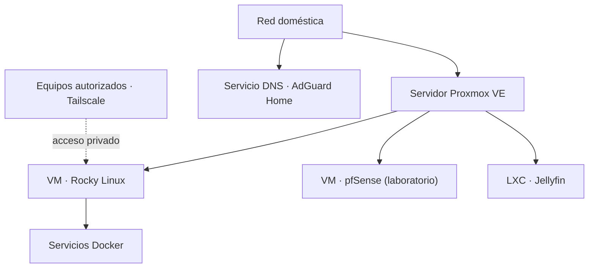

# Homelab — virtualización, Linux y redes

**Tipo:** laboratorio personal de infraestructura IT  
**Enfoque:** aprendizaje práctico, administración de sistemas y diagnóstico

## Objetivo

Mantengo un laboratorio para experimentar con virtualización, servicios Linux, redes y acceso remoto. Lo utilizo para practicar procedimientos que aparecen en tareas reales de soporte e infraestructura, sin confundir estas pruebas con la administración de una red empresarial.

## Componentes con los que trabajo

- **Proxmox VE:** host de virtualización para máquinas virtuales y contenedores.
- **Rocky Linux:** máquina virtual para ejecutar y administrar servicios, incluyendo aplicaciones contenerizadas con Docker.
- **pfSense:** entorno virtualizado para prácticas de firewall y redes; **no** lo presento como firewall principal de mi red doméstica.
- **Jellyfin:** servicio desplegado en un contenedor LXC.
- **AdGuard Home:** servicio DNS de mi red de laboratorio y hogar.
- **Tailscale:** acceso remoto entre equipos autorizados.

## Esquema simplificado



_La representación es ilustrativa: no muestra IP, subredes, puertos ni rutas de acceso y no indica que pfSense enrute el tráfico doméstico._

## Tareas técnicas que practico

1. Aprovisionar máquinas virtuales y contenedores según las necesidades de cada servicio.
2. Configurar conectividad, resolución DNS y acceso remoto.
3. Gestionar contenedores, estados de servicio, registros y reinicios controlados.
4. Diagnosticar fallos distinguiendo conectividad, DNS, aplicación y permisos.
5. Documentar cambios y verificar su resultado antes de tocar servicios que ya están en uso.

## Cómo verificaría un problema

Estos comandos ilustran parte de mi método de diagnóstico; **no son una captura de una prueba ejecutada**:

```bash
# En el host Proxmox: inventario de VM y contenedores
qm list
pct list

# En una máquina Linux con Docker: revisar servicios
docker compose ps
docker compose logs --tail=50

# Comprobar conectividad y DNS
ip route
getent hosts example.com
```

## Evidencia y limitaciones

El laboratorio está instalado en equipos personales y no publico configuraciones completas ni respaldos por seguridad. Este documento describe el entorno y mi alcance técnico, pero no sustituye una demostración: las siguientes evidencias útiles serían capturas anonimizadas del inventario de Proxmox, un servicio operativo y un procedimiento de diagnóstico realizado.

## Qué demuestra

Práctica con Linux, virtualización, contenedores, DNS, redes y resolución de incidentes, orientada a puestos de soporte técnico, infraestructura y administración de sistemas junior.
