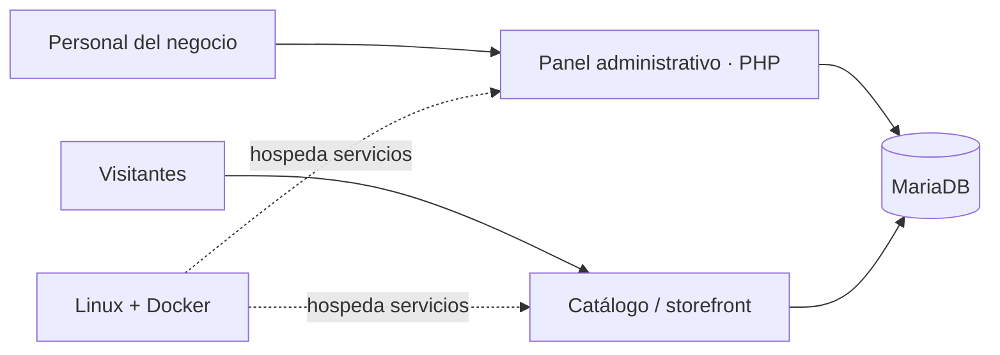

# Ltecobike — caso práctico de desarrollo e infraestructura

**Tipo:** sistema para un negocio familiar de motos eléctricas  
**Rol:** desarrollo, despliegue, administración y mantenimiento  
**Áreas:** PHP · MariaDB · Docker · Rocky Linux · seguridad y operación

## El problema

El negocio necesitaba centralizar tareas que atraviesan varias áreas: clientes, vehículos, ventas, repuestos, gastos, posventa y distribuidores. Además, requería una presencia web pública diferenciada de las herramientas de uso interno.

## Qué hice

- Desarrollé y mantengo funcionalidades de gestión para las operaciones del negocio.
- Desplegué los servicios de aplicación y base de datos en una infraestructura Linux con contenedores Docker.
- Organicé la separación entre el **panel interno** y la **web pública**, con sus necesidades de acceso y despliegue.
- Trabajé sobre controles de acceso por rol, autenticación reforzada para perfiles administrativos y trazabilidad de operaciones.
- Participé en el mantenimiento técnico y la evolución de la arquitectura, incluyendo el trabajo progresivo sobre un storefront con Laravel.

## Vista lógica de la solución

_Esquema conceptual: no representa direcciones, puertos, topología privada ni el estado exacto de cada entorno._

## Decisiones técnicas que puedo explicar

| Decisión | Razón |
| --- | --- |
| Contenedores Docker | Facilitar el despliegue y la administración de componentes separados |
| MariaDB | Persistir datos relacionados con las operaciones del sistema |
| Separación panel / web pública | Diferenciar usuarios, interfaces y superficie expuesta |
| Roles y auditoría | Restringir acciones por responsabilidad y rastrear operaciones |
| Evolución incremental del código | Mantener funcionalidades mientras se mejora la estructura técnica |

## Evidencia pública disponible

- [Repositorio LTeco ERP System](https://github.com/faku-20/LTeco-ERP-System): código de una evolución **genérica** del sistema, no una copia garantizada de la instancia de producción.
- [Documentación de arquitectura](https://github.com/faku-20/LTeco-ERP-System/blob/main/docs/ARQUITECTURA.md).
- [Guía de configuración y despliegue](https://github.com/faku-20/LTeco-ERP-System/blob/main/docs/SETUP.md).
- [Pruebas y herramientas de verificación](https://github.com/faku-20/LTeco-ERP-System/tree/main/tests).

## Estado y alcance

Es un proyecto en evolución. El repositorio público incluye componentes legacy y trabajo de modernización; la existencia de una funcionalidad en el código **no implica por sí sola** que esté desplegada ni validada para producción. No publico credenciales, datos de clientes, configuraciones privadas ni respaldos.

## Qué demuestra

Experiencia práctica para llevar un sistema más allá de la programación local: modelar funcionalidades reales, preparar entornos, desplegar servicios, diagnosticar problemas y mantener una solución a lo largo del tiempo.
