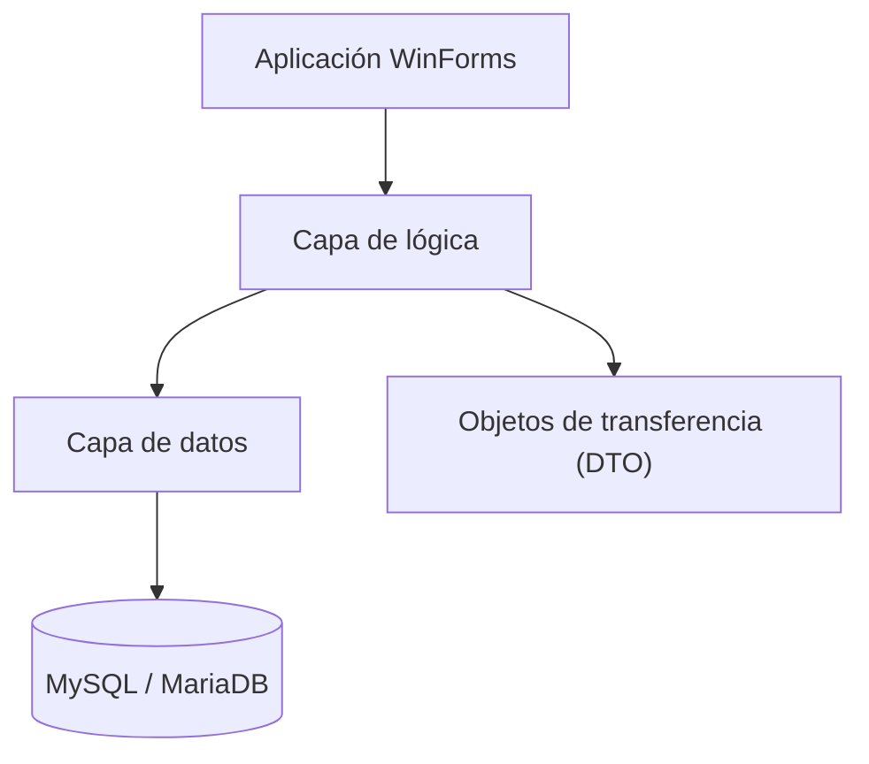

# S.I.G.T.O. / Sell Xpress — aplicación de escritorio y entorno de datos

**Tipo:** proyecto de software con varios perfiles de usuario  
**Tecnologías del proyecto:** C# · Windows Forms · .NET Framework · MySQL/MariaDB  
**Participación destacada en mi CV:** infraestructura, configuración del entorno de datos y despliegue de pruebas

## De qué trata

Aplicación de gestión de un marketplace, organizada en capas de **presentación, lógica, datos y DTO**. Incluye tres perfiles principales:

| Perfil | Funciones del sistema |
| --- | --- |
| BackOffice | Administración general de usuarios, empresas y productos |
| Empresa | Productos, stock, pedidos, ventas y promociones |
| Cliente | Catálogo, carrito, compras e historial |

La aplicación incorpora pantallas de dashboard, filtros, reportes exportables y validaciones en el flujo de compra.

## Mi aporte técnico

Participé en las tareas de infraestructura y configuración necesarias para probar el sistema: entorno Linux, servicios de base de datos MariaDB, contenedores Docker y prácticas de reglas de acceso con pfSense.

**Aclaración:** WinForms es una aplicación de escritorio Windows. Los contenedores corresponden a servicios de soporte y pruebas; esto no significa que toda la interfaz WinForms se ejecute dentro de Docker.

## Arquitectura lógica

Este esquema expresa la estructura del sistema; no es un mapa de infraestructura de producción.

## Qué se puede demostrar

- Diferencias entre las responsabilidades de los tres perfiles y las pantallas asociadas.
- Estructura de aplicación por capas y persistencia relacional.
- Preparación y conexión con una base de datos de prueba.
- Criterios de separación entre la app interna, servicios de infraestructura y una eventual API/web pública.

## Estado y visibilidad

El proyecto cuenta con capturas y material de demostración en su repositorio de trabajo, **actualmente privado**. Este resumen público no incluye el código, datos de demostración ni credenciales. Hasta publicar capturas anonimizadas o una demo revisada, debe considerarse una **descripción técnica**, no una demo pública verificable.

## Qué demuestra

Colaboración técnica en un sistema de varias capas y perfiles, preparación de entornos, bases de datos y diferenciación entre infraestructura y aplicación.
